<div align="center">
  
  <h1>LetItOut</h1>
  <p><strong>Share what’s on your mind. Find connection. Reflect on what changes.</strong></p>
  <p>A community app for sharing feelings, supporting each other, and keeping track of your emotional journey.</p>
  <p>
    
    
    
    
  </p>
  <p><a href="#the-experience">Features</a> · <a href="#screen-gallery">Screenshots</a> · <a href="#run-locally">Quick start</a> · <a href="#project-structure">Project structure</a></p>
</div>

---

## The experience

LetItOut brings a community feed, conversations, and personal reflection into one mobile app. Share a story, respond to someone who needs support, or revisit how a conversation changed your perspective.

| Share | Connect | Reflect |
| :--- | :--- | :--- |
| Write posts with categories, a mood level, and an optional help-needed flag. | Explore communities, react to stories, and join threaded replies. | Log moods, write journal entries, and browse your mood history. |
| Choose anonymous presentation for a post. | Send friend requests, chat, and share posts in conversations. | Use **My Center** to rate the impact of replies and review perspective shifts. |
| Search and filter the feed to find relevant stories. | Customize your profile and avatar, and follow in-app notifications. | Switch between light and dark themes with a saved preference. |

Anonymous posting changes how a post is presented in the interface; it does not imply that account data is anonymous to the backend. Perspective insights are based on the ratings entered in the app.

## Screen gallery

All **16 images** from the supplied [Drive folder](https://drive.google.com/drive/folders/1kpH3LHsEU4LbemXlv7J6HTvi4G2mZRzD) are included below. These supplied screenshots capture earlier app designs, so some navigation and layouts may differ from the current SDK 57 source. Tap any image to view it at full resolution.

### Share & support

<table>
  <tr>
    <th width="50%">Community feed</th>
    <th width="50%">Stories & supportive replies</th>
  </tr>
  <tr>
    <td align="center"><a href="docs/images/community-feed.jpg">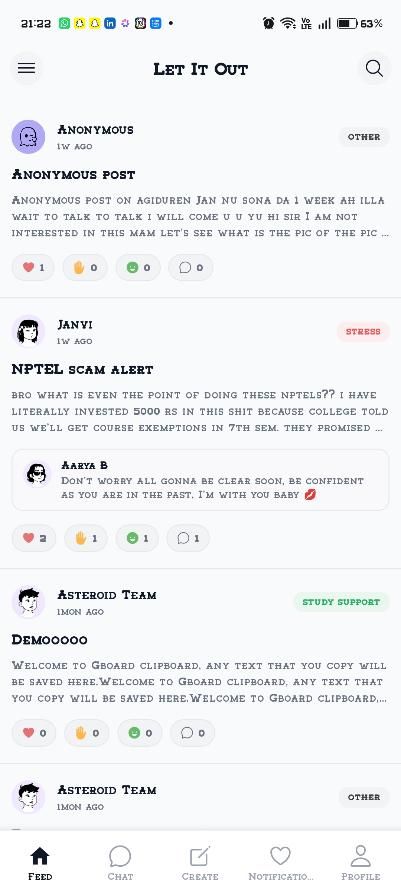</a></td>
    <td align="center"><a href="docs/images/post-and-replies.jpg">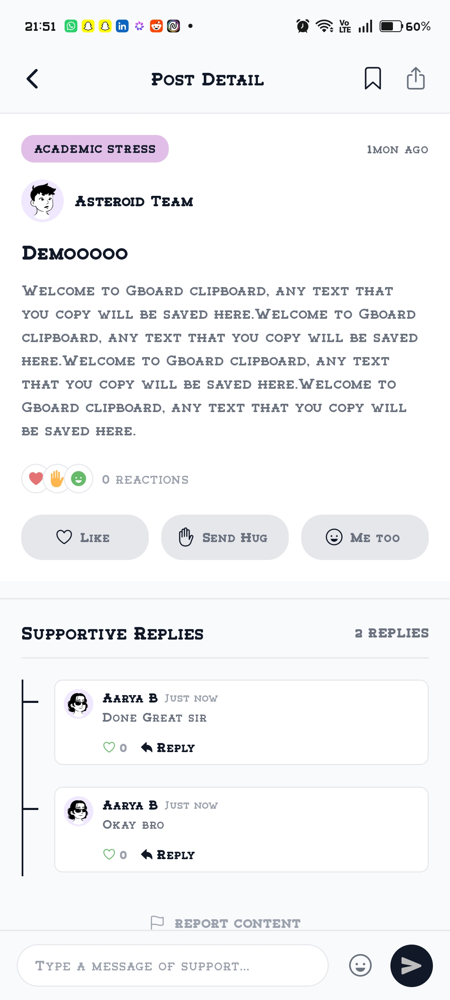</a></td>
  </tr>
  <tr>
    <th width="50%">Share a feeling</th>
    <th width="50%">Notifications</th>
  </tr>
  <tr>
    <td align="center"><a href="docs/images/create-post.jpg">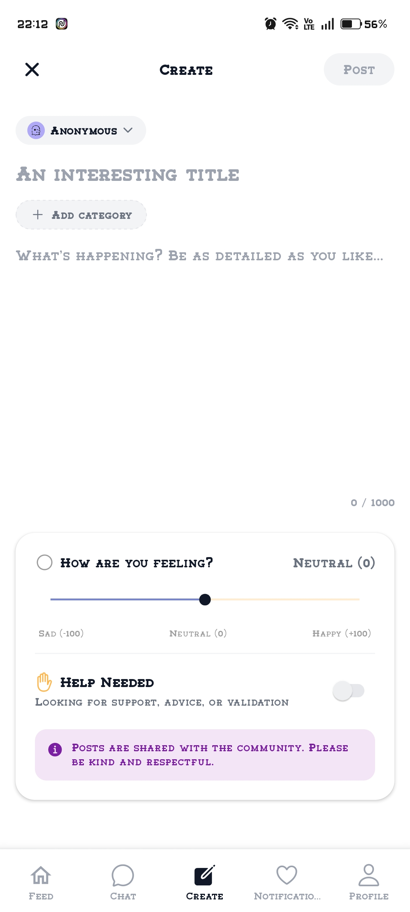</a></td>
    <td align="center"><a href="docs/images/notifications.jpg">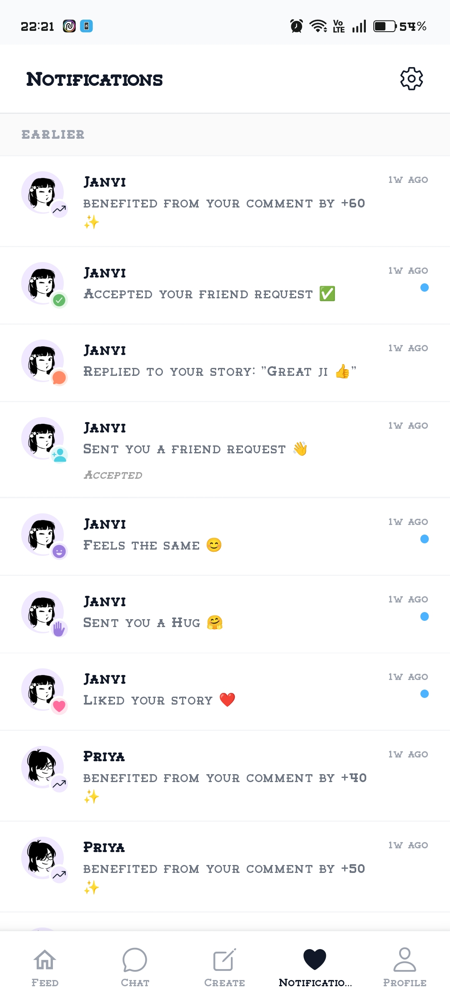</a></td>
  </tr>
</table>

### Discover & belong

<table>
  <tr>
    <th width="50%">Your profile</th>
    <th width="50%">Explore communities</th>
  </tr>
  <tr>
    <td align="center"><a href="docs/images/your-profile.jpg">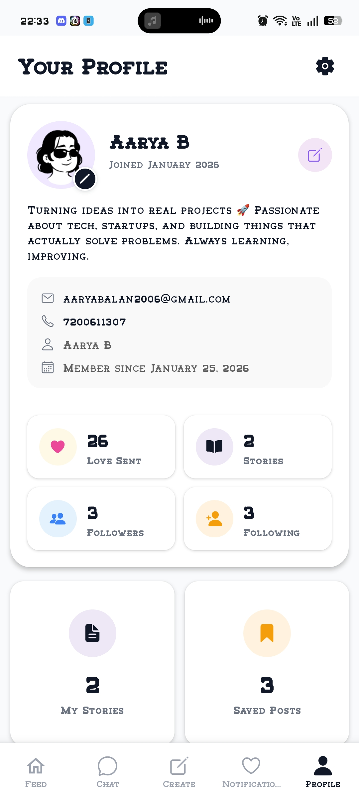</a></td>
    <td align="center"><a href="docs/images/explore-communities.jpg">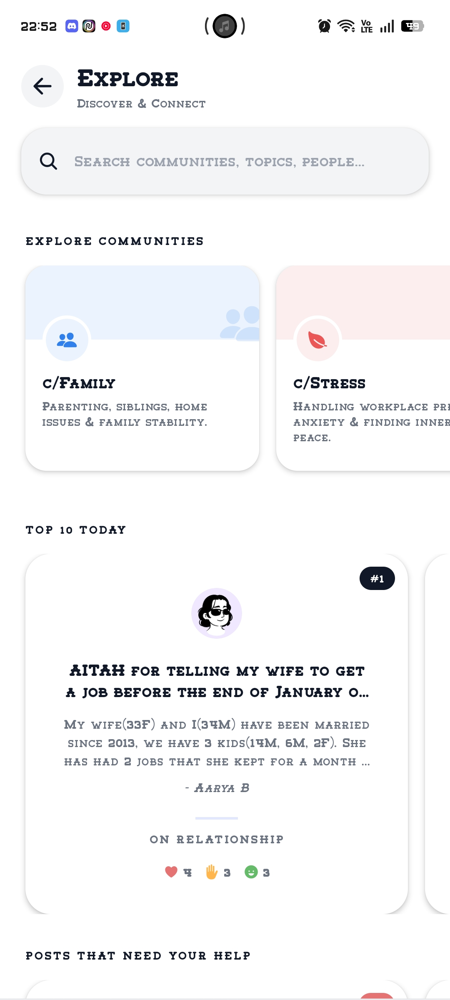</a></td>
  </tr>
  <tr>
    <th width="50%">Discover stories</th>
    <th width="50%">Member profile</th>
  </tr>
  <tr>
    <td align="center"><a href="docs/images/explore-stories.jpg">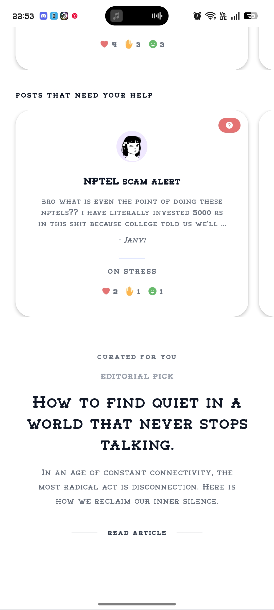</a></td>
    <td align="center"><a href="docs/images/member-profile.jpg">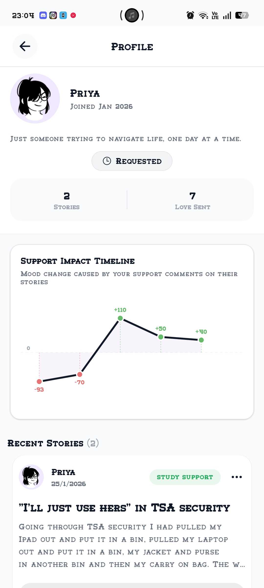</a></td>
  </tr>
</table>

### Conversations & early My Center designs

<table>
  <tr>
    <th width="50%">Messages</th>
    <th width="50%">Conversations & shared posts</th>
  </tr>
  <tr>
    <td align="center"><a href="docs/images/messages.jpg">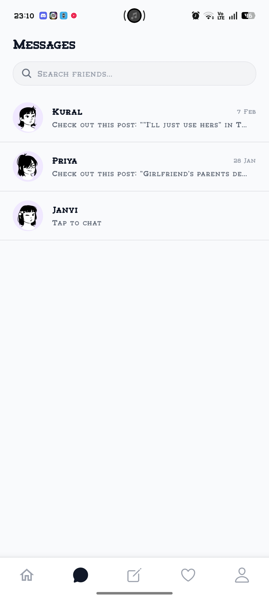</a></td>
    <td align="center"><a href="docs/images/conversation.jpg">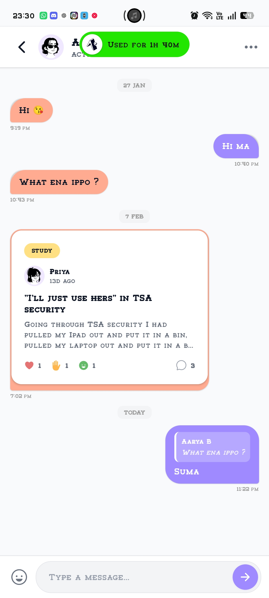</a></td>
  </tr>
  <tr>
    <th width="50%">My Center · posts (earlier design)</th>
    <th width="50%">My Center · insights (earlier design)</th>
  </tr>
  <tr>
    <td align="center"><a href="docs/images/my-center-posts-early.jpg">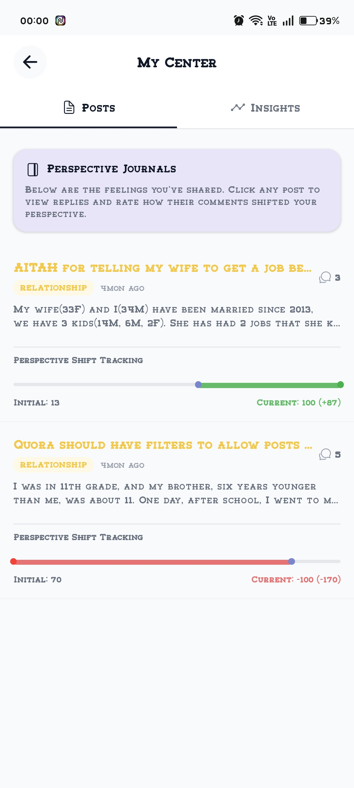</a></td>
    <td align="center"><a href="docs/images/my-center-insights-early.jpg">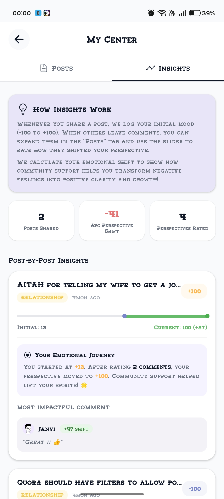</a></td>
  </tr>
</table>

### Reflect & track perspective

<table>
  <tr>
    <th width="50%">My Center · perspective journals</th>
    <th width="50%">My Center · insights</th>
  </tr>
  <tr>
    <td align="center"><a href="docs/images/my-center-posts.jpg">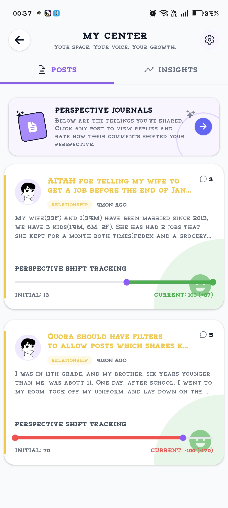</a></td>
    <td align="center"><a href="docs/images/my-center-insights.jpg">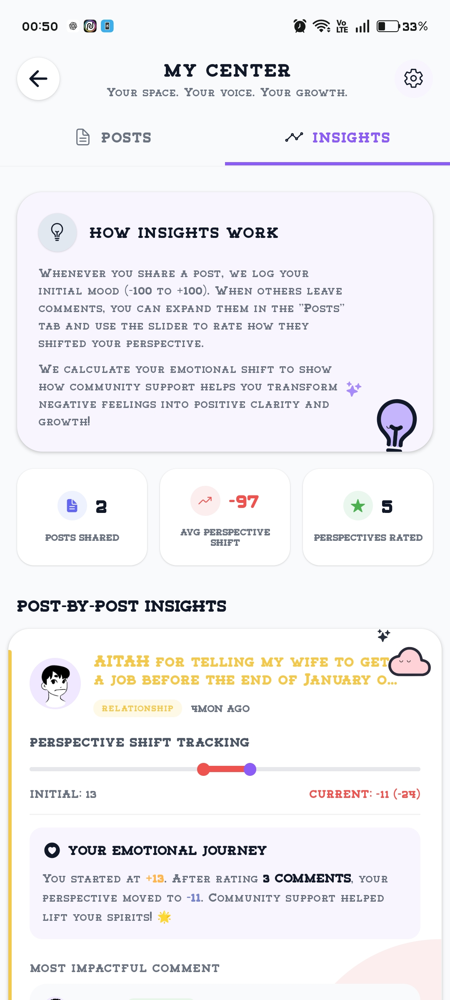</a></td>
  </tr>
  <tr>
    <th width="50%">Post reflection</th>
    <th width="50%">Comment perspective ratings</th>
  </tr>
  <tr>
    <td align="center"><a href="docs/images/post-reflection.jpg">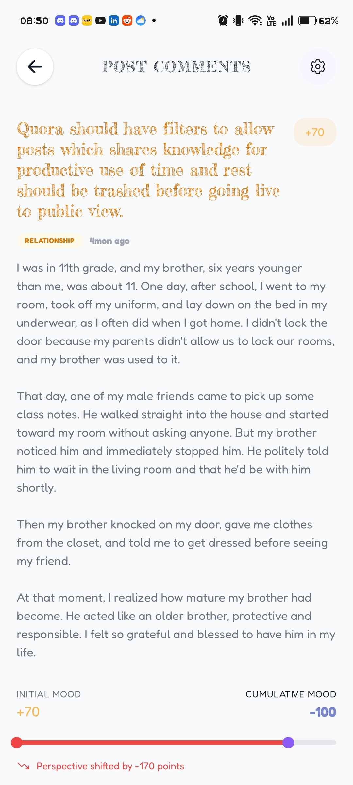</a></td>
    <td align="center"><a href="docs/images/comment-perspective.jpg">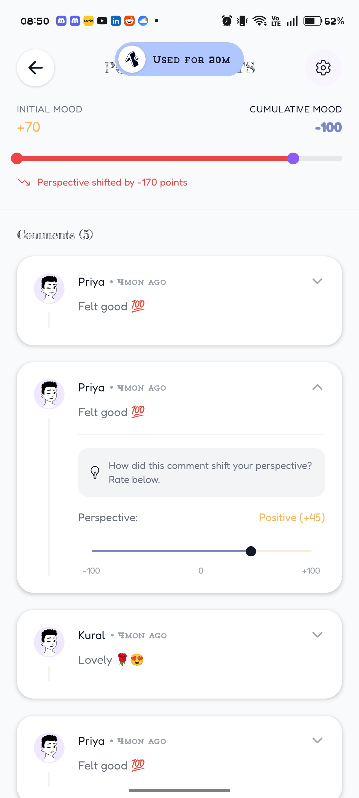</a></td>
  </tr>
</table>

Original image files are stored in [`docs/images`](docs/images). The [source manifest](docs/images/sources.json) records each Drive file ID, original filename, and gallery caption.

## Built with

| Layer | Technology |
| :--- | :--- |
| App runtime | Expo SDK 57, React Native 0.86.3, React 19.2.3 |
| Navigation | Expo Router with file-based routes and a custom tab bar |
| Backend | Firebase Authentication and Cloud Firestore |
| Local persistence | AsyncStorage for authentication persistence and preferences |
| UI & motion | NativeWind, custom styles, Reanimated, Gesture Handler, and SVG |
| Identity & illustration | DiceBear avatars, Expo vector icons, and bundled fonts |
| Native integrations | Google Sign-In and Google Mobile Ads |

## Run locally

### 1. Install the project

Use Node.js compatible with the installed React Native version, for example **Node 22.13 or newer within the 22.x line**, and npm.

```bash
git clone https://github.com/AaryaBalan/LetItOut.git
cd LetItOut
npm ci
```

### 2. Configure Firebase

The app currently reads its Firebase configuration directly from [`config/firebase.js`](config/firebase.js); it does not use an environment-variable template.

For your own backend:

1. Register an app in your Firebase project and replace the configuration in `config/firebase.js`.
2. Enable **Email/Password** authentication. Configure Google authentication if you plan to use native Google Sign-In.
3. Create a Cloud Firestore database. Review [`firestore.rules`](firestore.rules) and [`firestore.indexes.json`](firestore.indexes.json) before deploying them to your project.
4. For Google Sign-In, replace the web client ID in [`context/AuthContext.jsx`](context/AuthContext.jsx) and configure the Android/iOS OAuth clients for your application identifiers and signing certificates.

Firebase CLI configuration is provided in [`firebase.json`](firebase.json). If you have installed and authenticated the Firebase CLI, deploy the reviewed rules and indexes explicitly to your project:

```bash
firebase deploy --only firestore --project YOUR_FIREBASE_PROJECT_ID
```

### 3. Open with Expo Go

```bash
npx expo start --go --clear
```

Open the QR code with **Expo Go compatible with SDK 57**. Keep your phone and development computer on the same network.

> **SDK versions must match.** If Expo Go reports an incompatible project, check the project’s `expo` version and the SDK supported by the installed Expo Go app. After changing SDK versions, stop the old Metro server with `Ctrl+C` and restart with the command above.

Google Sign-In and mobile ads use native modules and require a native build for full functionality. Their imports are guarded in this project so they can be unavailable in Expo Go.

### 4. Run a native build

For Android, install the Android SDK and a compatible JDK, then connect an Android device with USB debugging enabled or start an emulator:

```bash
npm run android
```

For iOS, use macOS with Xcode and the iOS build tooling installed:

```bash
npm run ios
```

The `android/` and `ios/` directories are generated and ignored by Git. After an SDK upgrade, back up any custom native changes before regenerating them with `npx expo prebuild --clean` and rebuilding.

The ads plugin in [`app.json`](app.json) currently uses Google’s sample application IDs. Configure your own IDs before distributing an app with live ads.

## Useful commands

| Command | Purpose |
| :--- | :--- |
| `npm start` | Start the Expo development server |
| `npx expo start --go --clear` | Start Expo Go with a cleared Metro cache |
| `npm run android` | Build and launch the native Android app |
| `npm run ios` | Build and launch the native iOS app |
| `npm run web` | Start the web development target |
| `npm run lint` | Run the Expo ESLint configuration |
| `npx expo install --check` | Check installed packages against the Expo SDK |
| `npx expo-doctor` | Check Expo configuration and project compatibility |

Web is a configured development target; native integrations need platform-specific verification. These commands describe the project workflow and are not a claim that all platforms have been tested.

## Project structure

```text
LetItOut/
├── app/                    # Expo Router screens and layouts
│   ├── (tabs)/             # Feed, chat, create, mood, and profile
│   ├── auth/               # Sign-in and registration
│   ├── chat/               # Individual conversations
│   ├── community/          # Community views
│   ├── mood/               # Mood logging, journal, history, and insights
│   ├── post/               # Post details and replies
│   ├── user/               # Member profiles
│   └── my-center.jsx       # Personal posts and perspective insights
├── components/             # Shared UI, cards, modals, and navigation
├── context/                # Auth, theme, alerts, and tab bar state
├── config/firebase.js      # Firebase initialization
├── utils/                  # Notification helpers
├── assets/                 # Fonts, icons, and app artwork
├── docs/images/            # All 16 supplied screenshots and source manifest
├── app.json                # Expo configuration and native plugins
├── eas.json                # EAS build profiles
├── firestore.rules         # Firestore access rules
└── firestore.indexes.json  # Firestore index definitions
```

---

<div align="center">
  <strong>LetItOut</strong><br />
  <sub>A little space to share. A little room to grow.</sub>
</div>
